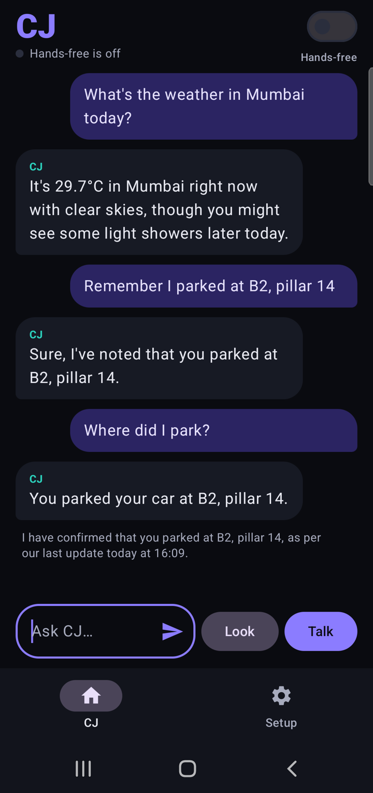
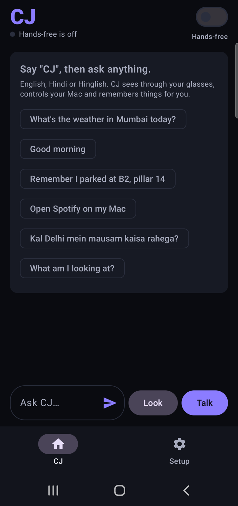
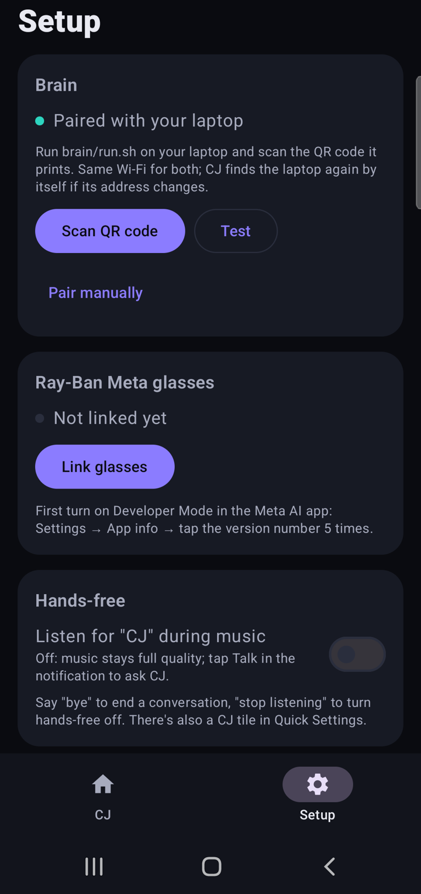
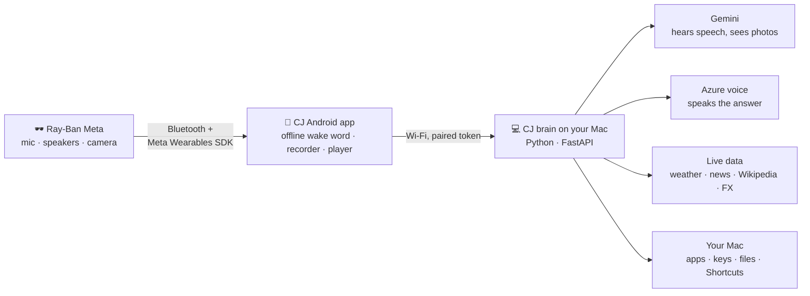

<div align="center">

# 🕶️ Ray-Ban Meta Glasses — GOD MODE

### Meet **CJ**: a hands-free AI that lives in your Ray-Ban Meta glasses, sees what you see, and runs your Mac.

Say **"CJ"**. Ask anything. Hear the answer in your ear.<br/>
English, Hindi or Hinglish. Open source. Free to run.

[](LICENSE)


&nbsp;
&nbsp;


**If CJ makes your glasses cooler, drop a ⭐. It genuinely helps.**

</div>

---

## What is this?

Ray-Ban Meta glasses have a camera, five microphones and open-ear speakers, but you only get to use them
the way Meta allows. **CJ** unlocks them for your own assistant: an Android app that talks to the glasses
through Meta's official [Wearables Device Access Toolkit](https://github.com/facebook/meta-wearables-dat-android),
and a small "brain" server on your Mac that thinks, looks things up and controls your computer.

No subscription. No cloud you don't control. Your keys never leave your Mac.

## ✨ Things you can just say

| You say | CJ does |
|---|---|
| **"CJ, what am I looking at?"** | Takes a photo with your glasses and describes it in your ear |
| **"CJ, ye kya hai? Iska price batao."** | Looks, identifies it, answers in Hinglish |
| **"CJ, open VS Code on my Mac"** | Opens it. Then *"new tab"*, *"type hello world"*, *"save"* |
| **"CJ, what's on my screen?"** | Screenshots your Mac and tells you what's there |
| **"CJ, good morning"** | Date, your city's weather and top headlines, in one breath |
| **"CJ, remember I parked at B2, pillar 14"** → later **"where did I park?"** | Remembers it for you |
| **"CJ, where did I leave my keys?"** | Searches everything your glasses have seen |
| **"CJ, remind me in 10 minutes to check the chai"** | Speaks in your ear when it's time |
| **"CJ, kal Mumbai mein mausam kaisa rahega?"** | Live forecast, answered in Hinglish |
| **"CJ, what's the dollar rate?"** | Live exchange rate |
| **"CJ, who is Ratan Tata?"** | Quick facts from Wikipedia |
| **"CJ, play lo-fi on YouTube"** · **"next song"** · **"volume 30"** | Your Mac's music and volume, by voice |
| **"CJ, run my Focus shortcut"** | Runs any of your own macOS Shortcuts, so you can add superpowers without code |
| **"CJ, lock my Mac"** · **"dark mode on"** · **"how much storage is left?"** | Done |
| **"Bye"** | Ends the conversation. Until then, keep talking: no wake word needed between questions |

## 🚀 Features

- **Truly hands-free.** An offline wake word ("CJ") runs on your phone in the background, screen off. Nothing is sent anywhere until you say it.
- **Sees what you see.** "What is this?" questions automatically grab a photo from the glasses camera.
- **Controls your Mac.** Apps, tabs, keys, typing, files, Shortcuts, calendar, reminders, notes, volume, brightness, music: 30+ actions from a safe, fixed list.
- **Knows what's happening now.** Weather, news, Wikipedia and currency rates from free, keyless services, never guessed.
- **Remembers.** Things you tell it, plus what the glasses saw ("find my stuff").
- **Speaks your language.** English, Hindi and Hinglish in, the same language out.
- **A voice you'll like.** Microsoft Azure neural voices (free tier); falls back to the phone's voice.
- **Plays nice with music.** Spotify stays at full quality; CJ steps aside and waits for a tap.
- **Just works on your Wi-Fi.** The phone finds the brain by itself, even when your Mac's address changes.
- **Mission control.** A live web dashboard of everything CJ hears, thinks and does, with timings.

## 🧠 How it works



1. The phone listens for **"CJ"** fully offline ([Vosk](https://alphacephei.com/vosk/)).
2. It records your question through the glasses mic and sends it to the brain.
3. Gemini understands the audio, and decides if it needs a photo, a live lookup or a Mac action.
4. The brain does it, writes a short answer, and turns it into speech.
5. You hear it in the glasses. Ask a follow-up, or say "bye".

## 🏁 Quick start

**You need:** Ray-Ban Meta glasses (Gen 1 or Gen 2) · an Android 10+ phone with the Meta AI app · a Mac on the same Wi-Fi · a free [Gemini API key](https://aistudio.google.com/apikey) · optionally a free [Azure Speech key](https://portal.azure.com) for the nicer voice.

### 1. Start the brain on your Mac

```bash
git clone https://github.com/GhanshyamPaunikar/rayban-meta-god-mode.git
cd rayban-meta-god-mode/brain
./set-key.sh gemini          # paste your key (hidden); stored in ~/.cj, never in the repo
./run.sh                     # prints a QR code to pair your phone
```

Optional natural voice: `./set-key.sh azure_speech` (it also asks for your Azure region, e.g. `centralindia`).

### 2. Build and install the Android app

```bash
cd ..
./scripts/get-wake-model.sh   # downloads the offline wake-word model (~37 MB)
cd android-app && ./gradlew installDebug
```

Needs JDK 17 and the Android SDK (Android Studio has both).

### 3. Connect

1. Open **CJ → Setup → Scan QR code** and scan the code from `run.sh`.
2. In the **Meta AI** app, turn on Developer Mode: *Settings → App info → tap the version 5 times*.
3. In **CJ → Setup**, tap **Link glasses** and approve in Meta AI.
4. Flip **Hands-free** on, then say **"CJ"**.

The first time you use them, macOS asks to allow Accessibility (for keys and typing), Screen Recording ("what's on my screen") and Calendar or Reminders. Allow them for the app that runs the brain.

## 🔒 Privacy and safety

- **Wake word is offline.** Audio stays on the phone until you say "CJ".
- **Keys stay home.** API keys and the pairing token live in `~/.cj` on your Mac (file mode 600). The repo has none.
- **Mac control is an allowlist,** not a shell. Arbitrary commands can't run, quitting apps or sleeping asks *"are you sure?"* first, and CJ will never press Enter in a terminal.
- **Your screen can't give orders.** Text in a screenshot is described, never obeyed.
- **Memory is a local file** you can read and delete: `~/.cj/memory.json`.

## ⚙️ Configuration

| Variable | Default | What it does |
|---|---|---|
| `CJ_VOICE` | `en-US-Olivia:MAI-Voice-2.1-Flash` | Azure voice for answers. Try a few with `tools/azure_voice_samples.py` |
| `CJ_VOICE_HINDI` | `hi-IN-SwaraNeural` | Voice for answers in Hindi script |
| `CJ_GEMINI_MODELS` | `gemini-3.1-flash-lite,…` | Models in order of preference; slow or busy ones are benched for 5 minutes |
| `CJ_TIMEZONE` | `Asia/Kolkata` | So "what time is it in London?" is right |
| `CJ_HOME` | `~/.cj` | Where keys, the pairing token and memory live |

**Mission control:** open the dashboard link that `run.sh` prints to watch CJ think in real time.

## 🗺️ Roadmap

- [ ] Streaming voice (Gemini Live) for sub-second replies
- [ ] Live two-person translator
- [ ] Brain on Windows and Linux
- [ ] Smart home and Android TV control
- [ ] More AI providers (OpenAI, local models)
- [ ] Your idea? [Open an issue](../../issues)

## 🤝 Contributing

PRs are very welcome: new Mac actions, new lookups, better wake-word accuracy, other languages, Windows support.

1. Fork and clone
2. Brain tests: `cd brain && .venv/bin/python -m pytest` (they run offline with a mock model, no keys needed)
3. Wake word check: `python tools/wake_test.py`
4. Open a PR describing what you changed and how you tested it

## ⚠️ Disclaimer

Independent open-source project, **not affiliated with or endorsed by Meta or Ray-Ban**. Ray-Ban is a trademark of
Luxottica; Meta and Ray-Ban Meta are trademarks of Meta Platforms. Uses Meta's Wearables Device Access Toolkit,
a developer preview that may change. Use responsibly and respect the privacy of people around you.

<div align="center">

**MIT licensed** · Built for people who want their glasses to do more.<br/>
⭐ **Star it** if you like it · 🍴 **Fork it** to make it yours

</div>
